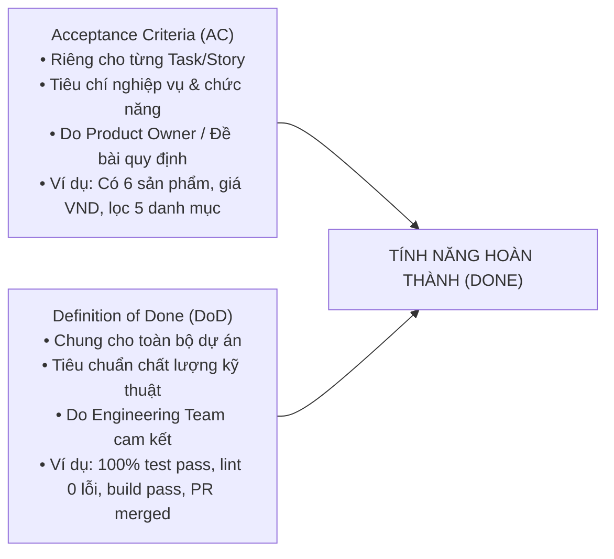

# BREWLITE — DEFINITION OF DONE (DoD)

| Thông tin chuẩn mực | Chi tiết |
|---|---|
| **Dự án** | BrewLite — Hệ thống đặt cà phê và thanh toán không tiền mặt |
| **Phạm vi áp dụng** | Toàn bộ các User Story, Task và Pull Request trong mọi Sprint (Sprint 1, 2, 3) |
| **Mục đích** | Thiết lập tiêu chuẩn chất lượng kỹ thuật thống nhất, đảm bảo mọi tính năng khi chuyển sang trạng thái **DONE** đều sẵn sàng bàn giao, không có lỗi tiềm ẩn và có tài liệu kiểm chứng minh bạch. |

---

## 1. Phân biệt Definition of Done (DoD) và Acceptance Criteria (AC)

Trong quy trình Agile Scrum của dự án BrewLite, hai khái niệm này được phân định rõ ràng như sau:



- **Acceptance Criteria (AC) — Tiêu chí chấp nhận:** Là tập hợp các yêu cầu chức năng, luồng nghiệp vụ cụ thể gắn liền với từng User Story/Task đơn lẻ (ví dụ: Task 2 cần trả về mảng 6 phần tử JSON; Task 3 phải có 4 trạng thái giao diện...). Nếu chưa thỏa mãn AC thì tính năng chưa hoàn thành mục tiêu nghiệp vụ.
- **Definition of Done (DoD) — Định nghĩa hoàn thành:** Là danh mục kiểm tra chất lượng kỹ thuật chung áp dụng đồng đều cho **mọi hạng mục** trước khi được đóng. Dù một tính năng đã chạy được trên máy cá nhân, nhưng nếu chưa có test, chưa qua linter hoặc PR chưa merge thì vẫn **KHÔNG ĐƯỢC COI LÀ DONE**.

---

## 2. Tiêu chuẩn Definition of Done chuẩn mực của BrewLite

Một Task chỉ được chuyển sang trạng thái **DONE** khi đáp ứng đầy đủ 9 tiêu chí bắt buộc dưới đây:

### 1. Hoàn thành đầy đủ phạm vi chức năng (Functional Scope Complete)
- Mã nguồn thực thi đầy đủ các chức năng theo đúng mô tả trong Product Backlog và Sprint Backlog.
- Không để lại mã giả lập (mock ngầm), mã tạm thời (stub) hoặc các đoạn mã dở dang nếu không nằm trong thỏa thuận kỹ thuật được ghi nhận.

### 2. Thỏa mãn 100% Acceptance Criteria của Task
- Mọi tiêu chí nghiệp vụ (AC) được định nghĩa cho Task đó đều phải được kiểm tra và đánh giá đạt (**PASS**).

### 3. Đạt yêu cầu kiểm thử tự động (Automated Testing)
- **Unit Tests:** Mọi service, utility, helper, controller mới đều phải có unit test bao phủ các nhánh thành công lẫn ngoại lệ.
- **Component Tests (Frontend):** Các component giao diện quan trọng phải được test các trạng thái render bằng Vitest và React Testing Library.
- **Integration / E2E Tests (Backend):** Các API endpoint mới phải có HTTP test kiểm tra status code, header và cấu trúc JSON trả về.
- **Không gây hồi quy (No Regression):** 100% toàn bộ test suite hiện có của cả hệ thống (cũ và mới) đều phải chạy thành công (Exit code 0).

### 4. Đạt chuẩn tĩnh mã nguồn và định dạng (Linting & Formatting)
- Chạy lệnh kiểm tra linter toàn hệ thống: `npm run lint`.
- Không có bất kỳ cảnh báo (warning) hay lỗi cú pháp (error) nào chưa được xử lý.
- Tuân thủ quy ước đặt tên file, cấu trúc thư mục, quy tắc TypeScript và kiểu dữ liệu nghiêm ngặt (`strict: true`).

### 5. Biên dịch sản xuất thành công (Production Build)
- Chạy lệnh build toàn bộ dự án: `npm run build`.
- Cả `frontend` (Next.js production build) và `backend` (NestJS dist build) phải biên dịch thành công mà không phát sinh lỗi kiểu (type-check errors) hay thiếu sót tài nguyên tĩnh.

### 6. Rà soát mã nguồn (Code Review)
- Mỗi tính năng phải được phát triển trên nhánh tính năng riêng biệt (`feature/*`, `fix/*`, `docs/*`).
- Mở Pull Request (PR) rõ ràng, có tiêu đề chuẩn Conventional Commits và mô tả chi tiết các thay đổi.
- Được xem xét kỹ lưỡng (peer review / tech lead review), giải quyết triệt để mọi phản hồi và xác nhận không có xung đột (mergeable state: clean).

### 7. Tích hợp nhánh chính (Pull Request Merged)
- Pull Request đã được merge chính thức vào nhánh `main` trên GitHub remote.
- Lịch sử Git sạch sẽ, rõ ràng, không force-push đè lịch sử của đồng đội.
- Nhánh tính năng sau khi merge có thể được dọn dẹp hoặc lưu trữ phù hợp.

### 8. Cập nhật tài liệu kỹ thuật & quản lý (Documentation Updated)
- Cập nhật tài liệu hướng dẫn [README.md](../../README.md) nếu có thay đổi về môi trường, lệnh chạy hoặc cấu trúc API.
- Lập báo cáo nghiệm thu chuyên biệt trong thư mục `docs/` (ví dụ: `docs/TASK-xx.md`).
- Cập nhật trạng thái của Task trong Product Backlog và Sprint Backlog từ `TO DO` / `IN PROGRESS` sang `DONE`.

### 9. Bằng chứng thực nghiệm (Demonstration & Evidence)
- Cung cấp bằng chứng thực nghiệm rõ ràng: ảnh chụp màn hình giao diện thực tế (responsive, desktop, mobile), bản ghi log phản hồi API (curl, Invoke-RestMethod) hoặc báo cáo kết quả kiểm thử.

---

## 3. Bảng kiểm tra nghiệm thu nhanh (DoD Checklist)

Trước khi đóng bất kỳ PR nào, kỹ sư phụ trách cần rà soát qua bảng kiểm tra sau:

```markdown
- [ ] 1. Phạm vi chức năng hoàn thành đúng theo mô tả đề bài.
- [ ] 2. 100% Acceptance Criteria của Task được thỏa mãn.
- [ ] 3. Đã viết Unit/Component/E2E test và toàn bộ test suite pass: `npm test`.
- [ ] 4. Linter không phát sinh lỗi hoặc cảnh báo: `npm run lint`.
- [ ] 5. Biên dịch sản xuất thành công: `npm run build`.
- [ ] 6. Code review hoàn tất, không còn phản hồi tồn đọng.
- [ ] 7. Pull Request đã merge vào nhánh main trên GitHub.
- [ ] 8. Tài liệu kỹ thuật và tài liệu Scrum đã được cập nhật.
- [ ] 9. Đã đính kèm ảnh chụp giao diện hoặc log kiểm chứng thực tế.
```
