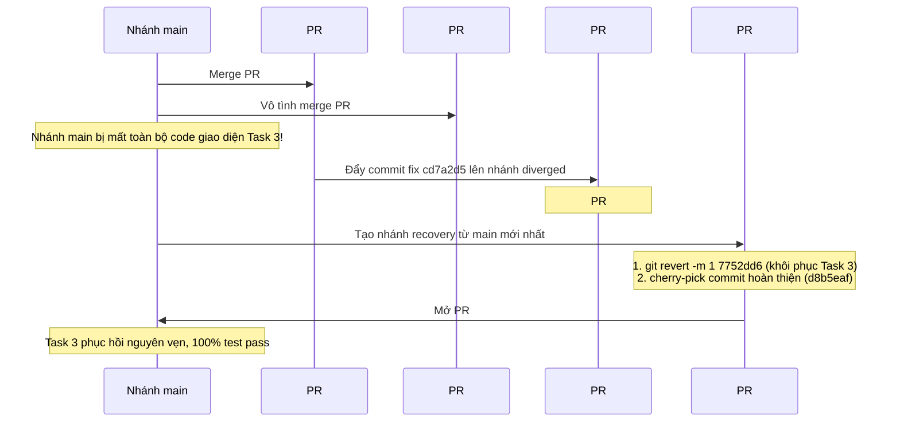

# BREWLITE — SPRINT 1 PROGRESS TRACKING & IMPEDIMENTS LOG

| Thông tin theo dõi | Chi tiết |
|---|---|
| **Dự án** | BrewLite (Assignment 1) |
| **Sprint** | Sprint 1 — Nền tảng & Hiển thị Menu |
| **Nhánh chính** | [`main`](https://github.com/vohuunghiaah/brewlite_v01/tree/main) |
| **GitHub Project Board** | [**`BrewLite ASM1 — Scrum Management` (Project #3)**](https://github.com/users/vohuunghiaah/projects/3) |
| **Thời điểm lập hồ sơ** | Sau khi phục hồi và merge thành công Task 3 (PR #6), trước khi bắt đầu Task 4 |
| **Người thực hiện** | Scrum Technical Lead & Engineering Team |

---

## 1. Trạng thái tiến độ thực tế (Burndown / Status Overview)

```text
[Sprint 1 Scope: 4 Tasks]
├── [DONE]  Task 1: Khởi tạo dự án & Monorepo (Issue #8 - PR #1 - a60b9d6)
├── [DONE]  Task 2: API danh sách sản phẩm (Issue #9 - PR #2 - c72c1c1)
├── [DONE]  Task 3: Trang Menu Frontend (Issue #10 - PR #6 - 6737476)
└── [TO DO] Task 4: Chi tiết & tùy chọn sản phẩm (Issue #11 - Chưa bắt đầu)
```

- **Tỷ lệ hoàn thành công việc Sprint 1:** **75% (3/4 Tasks đã hoàn tất và tích hợp vào `main`)**.
- **Chất lượng kỹ thuật hiện tại trên nhánh `main`:**
  - 100% Monorepo Unit/Component tests passed (**36/36 tests**).
  - 100% Backend E2E tests passed (**6/6 tests**).
  - Linter: **0 lỗi, 0 cảnh báo**.
  - Production build: Thành công 100% cho cả Next.js và NestJS.

---

## 2. Ghi nhận các sự cố Git thực tế & Phương án xử lý (Real Git Incidents)

Trong quá trình thực hiện Sprint 1, nhóm đã gặp và xử lý thành công một sự cố Git phân nhánh và revert phức tạp liên quan đến Task 3:



### Chi tiết diễn biến sự cố:
1. **PR #3 merged:** Ban đầu PR #3 tích hợp mã nguồn Task 3 vào `main` tại commit `42343c1`.
2. **PR #4 revert ngoài ý muốn:** Một PR revert tự động (#4) được merge vào `main` tại commit `7752dd6b7082d965499f666fd99dd1644523faf2`, khiến toàn bộ giao diện Menu bị xóa khỏi nhánh `main`.
3. **PR #5 bị tắc nghẽn (Dirty State):** Khi nhóm cố gắng tích hợp bổ sung các bản sửa nâng cao của Task 3 từ commit `7ac800e`, PR #5 rơi vào trạng thái xung đột (`mergeable_state: dirty`) do nhánh đã bị phân nhánh (diverged).
4. **Giải pháp xử lý triệt để qua PR #6:**
   - Thay vì force-push làm hỏng lịch sử Git của repository, nhóm tuân thủ phương pháp chuẩn mực: tạo nhánh phục hồi `fix/task-03-recovery-and-final-review` từ `origin/main`.
   - Thực thi `git revert -m 1 7752dd6` tạo commit `f398596` để hoàn tác lại lệnh revert.
   - Sau đó cherry-pick commit nâng cấp hoàn thiện `d8b5eaf` (Navbar callbacks, runtime validation, component tests).
   - Xác minh toàn bộ 36 tests và production build pass 100%.
   - Mở PR [#6](https://github.com/vohuunghiaah/brewlite_v01/pull/6) và đã được merge sạch sẽ vào `main` tại commit `6737476`.

---

## 3. Nhật ký trở ngại kỹ thuật & Quyết định kiến trúc (Impediments & Decisions Log)

| Mã | Trở ngại / Vấn đề phát sinh | Quyết định kỹ thuật & Biện pháp khắc phục | Bằng chứng kiểm tra |
|:---:|---|---|---|
| **IMP-01** | **Xung đột cổng cục bộ 3000 / 3001:** Tiến trình Node.js cũ chạy ngầm chiếm cổng khiến dev server không lắng nghe được. | Sử dụng PowerShell WMI (`Get-CimInstance Win32_Process`) truy vết PID tiến trình chiếm cổng và dừng dứt điểm bằng `Stop-Process`. Thêm cơ chế fallback cổng cấu hình qua biến `.env`. | Cả hai cổng 3000 và 3001 hoạt động ổn định, độc lập. |
| **IMP-02** | **Sai lệch tài nguyên ảnh `coffee-004.svg`:** Thiết kế gốc mô tả Espresso, nhưng thực đơn đổi thành món Cold Brew Muối. | Thiết kế lại vector SVG cho ly Cold Brew Muối với lớp kem bọt biển đặc trưng, kích thước chuẩn 240x240, đồng bộ hoàn toàn với Figma Make. | Ảnh hiển thị sắc nét tại `frontend/public/products/coffee-004.svg`. |
| **IMP-03** | **Đồng bộ nhãn tiếp thị (Badge):** Figma sử dụng các nhãn như "Bán chạy", "Mới", "Hot Trend", "Yêu thích". | Bổ sung trường tùy chọn `badge?: string` vào `Product` interface và API NestJS mà không làm thay đổi các trường dữ liệu bắt buộc cũ. | Test `products.service.spec.ts` và `products.controller.spec.ts` pass 100%. |
| **IMP-04** | **Bảo vệ toàn vẹn dữ liệu API phía Client:** Nguy cơ API trả về dữ liệu rác, thiếu trường gây crash UI. | Xây dựng hàm kiểm định thời gian chạy `validateProductList()` và `validateProduct()` tại `frontend/lib/api.ts`, tự động ném exception để MenuPage chuyển sang Error State an toàn. | 8 ca kiểm thử ngoại lệ malformed payload trong `api.spec.ts` pass 100%. |
| **IMP-05** | **Các nút chức năng chưa phát triển (Navbar, Add to cart):** Nút Giỏ hàng, Đăng nhập và Tùy chỉnh chưa có logic xử lý. | Tách riêng các callback độc lập (`onCartClick`, `onHistoryClick`, `onAccountClick`), kết hợp hệ thống Toast thông báo rõ ràng về phạm vi Task 4/Task 5, tránh gây hiểu lầm cho người dùng. | Kiểm thử tương tác trong `MenuPage.spec.tsx` xác nhận Toast hiển thị chuẩn xác. |

---

## 4. Kế hoạch công việc tiếp theo (Next Steps for Sprint 1 Completion)

1. **Chuẩn bị triển khai Task 4 (Chi tiết & tùy chọn sản phẩm):**
   - Thiết kế Component Modal chi tiết sản phẩm (khi click vào card hoặc nút "Tùy chỉnh").
   - Hiện thực bộ chọn kích cỡ: Size S (+0đ), Size M (+5.000đ hoặc giá cấu hình), Size L (+10.000đ).
   - Hiện thực bộ chọn nhiều Topping (Trân châu trắng, Thạch cà phê, Kem cheese...).
   - Tính toán tổng giá tức thời theo công thức: `Tổng tiền = (Giá gốc + Giá Size + Tổng giá Topping) x Số lượng`.
   - Viết unit test cho logic tính giá và component test cho giao diện Modal.
2. **Rà soát Definition of Done:** Chạy full suite kiểm thử, kiểm tra linter và production build.
3. **Mở Pull Request cho Task 4:** Đảm bảo code review đạt trước khi merge vào `main`.
4. **Sprint 1 Review & Retrospective:** Tổng kết Sprint 1 và chuẩn bị bước sang Sprint 2 (Task 5: Giỏ hàng).

---

## 5. Mẫu báo cáo Daily Scrum cho các ngày tiếp theo (Daily Scrum Template)

> [!NOTE]
> Để đảm bảo tính trung thực lịch sử, dự án **không tự tạo nhật ký họp giả trong quá khứ**. Khi nhóm bước vào triển khai Task 4 và các Sprint tiếp theo, các thành viên sẽ sử dụng mẫu Daily Scrum chuẩn mực dưới đây:

```markdown
### Nhật ký Daily Scrum — Ngày: [YYYY-MM-DD]
- **Thành viên:** [Tên thành viên / Vai trò]
- **1. Hôm qua tôi đã hoàn thành những gì để đóng góp vào Sprint Goal?**
  - [Ví dụ: Đã dựng xong giao diện Modal tùy chọn kích cỡ cho Task 4]
- **2. Hôm nay tôi sẽ làm gì để hỗ trợ Nhóm đạt được Sprint Goal?**
  - [Ví dụ: Viết logic tính giá động và bổ sung unit test cho Topping selector]
- **3. Tôi đang gặp phải những trở ngại (impediments) nào cản trở tiến độ không?**
  - [Ví dụ: Không có / Đang cần làm rõ bảng giá topping chuẩn với Product Owner]
```
