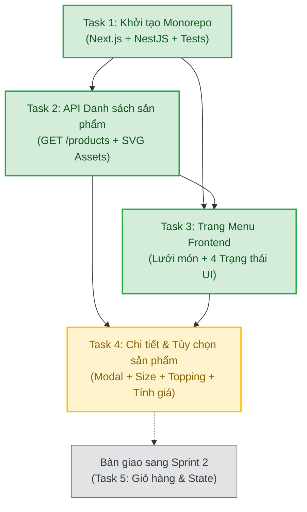

# BREWLITE — SPRINT 1 BACKLOG & MANAGEMENT

| Thông tin Sprint | Chi tiết |
|---|---|
| **Sprint** | Sprint 1 — Nền tảng & Hiển thị Menu (Foundation & Menu Showcase) |
| **Dự án** | BrewLite (Assignment 1) |
| **Repository** | [`vohuunghiaah/brewlite_v01`](https://github.com/vohuunghiaah/brewlite_v01) |
| **GitHub Project Board** | [**`BrewLite ASM1 — Scrum Management` (Project #3)**](https://github.com/users/vohuunghiaah/projects/3) |
| **Mục tiêu Sprint (Sprint Goal)** | Xây dựng nền tảng Monorepo chuẩn mực (Frontend + Backend), cung cấp API thực đơn và hiển thị giao diện Menu sản phẩm cùng hộp thoại tùy biến theo thiết kế chuẩn Figma Make App. |
| **Phạm vi công việc** | Task 1, Task 2, Task 3, Task 4 |
| **Trạng thái Sprint** | **ĐANG TIẾN HÀNH (IN PROGRESS)** |
| **Thời gian bắt đầu / kết thúc** | **Chưa xác nhận** *(Lịch đề xuất trên GitHub Iterations: 16/11/2026 – 29/11/2026)* |
| **Tài liệu tham chiếu** | [product-backlog.md](product-backlog.md), [definition-of-done.md](definition-of-done.md), [sprint-01-progress.md](sprint-01-progress.md), [github-project-tracking.md](github-project-tracking.md) |

---

## 1. Bối cảnh & Nguyên tắc thiết lập hồ sơ quản lý

> [!IMPORTANT]
> **Phân định rõ ràng về mặt phương pháp luận:**
> 1. **Kế hoạch gợi ý từ đề bài:** Đề bài Assignment 1 gợi ý phân chia dự án thành 3 Sprint, trong đó Sprint 1 bao gồm 4 Task đầu tiên (Task 1 đến Task 4).
> 2. **Công việc kỹ thuật đã thực hiện:** Nhóm đã hoàn thành độc lập và merge thành công Task 1 (PR #1), Task 2 (PR #2) và Task 3 (PR #6).
> 3. **Hồ sơ quản lý bổ sung tại thời điểm hiện tại:** Tài liệu Scrum này được thiết lập tại thời điểm giao thoa giữa Task 3 và Task 4 để chuẩn hóa quy trình Agile, không viết lại lịch sử dự án, không bịa đặt các biên bản cuộc họp Sprint Planning hay Daily Scrum giả trong quá khứ.

### Đề xuất Timebox cho Sprint 1:
- **Tình trạng:** Thời điểm bắt đầu chính thức của đồ án chưa được nhóm chốt bằng văn bản cụ thể.
- **Đề xuất kỹ thuật:** Timebox chuẩn cho Sprint 1 là 2 tuần (16/11/2026 – 29/11/2026 trên GitHub Project Iteration). Với 3/4 khối lượng công việc đã hoàn thành, thời gian ước tính hợp lý để hoàn thành Task 4, kiểm thử toàn diện và đóng Sprint 1 là **khoảng 2 – 3 ngày làm việc tập trung**.
- *Ghi chú:* Đề xuất này là định hướng kế hoạch, tuyệt đối không trình bày như một lịch trình đã diễn ra.

---

## 2. Sprint Backlog & Trạng thái chi tiết (Task 1 – Task 4)

| Mã Task | GitHub Issue | Tên công việc | Hạng mục kỹ thuật | Trạng thái | Bằng chứng Git / PR |
|:---:|:---:|---|---|:---:|---|
| **TASK-01** | [#8](https://github.com/vohuunghiaah/brewlite_v01/issues/8) | Khởi tạo dự án và cấu trúc | Monorepo Next.js + NestJS, kiểm tra sức khỏe `GET /` | **DONE** | [PR #1](https://github.com/vohuunghiaah/brewlite_v01/pull/1) (`a60b9d6`) |
| **TASK-02** | [#9](https://github.com/vohuunghiaah/brewlite_v01/issues/9) | API danh sách sản phẩm | NestJS `GET /products`, dữ liệu mẫu, SVG vector images | **DONE** | [PR #2](https://github.com/vohuunghiaah/brewlite_v01/pull/2) (`c72c1c1`) |
| **TASK-03** | [#10](https://github.com/vohuunghiaah/brewlite_v01/issues/10) | Trang Menu Frontend | Next.js gọi API, lưới món, 4 trạng thái UI, responsive | **DONE** | [PR #6](https://github.com/vohuunghiaah/brewlite_v01/pull/6) (`6737476`) |
| **TASK-04** | [#11](https://github.com/vohuunghiaah/brewlite_v01/issues/11) | Chi tiết & tùy chọn sản phẩm | Modal/trang chi tiết: chọn Size S/M/L, Topping, tính giá động | **TO DO** | Chưa bắt đầu |

---

## 3. Sản phẩm bàn giao của Sprint 1 (Deliverables)

Khi hoàn tất toàn bộ Sprint 1, hệ thống BrewLite đạt được các sản phẩm bàn giao cụ thể:
1. **Kiến trúc Monorepo hoàn chỉnh:** Quản lý tập trung `frontend/` và `backend/`, cài đặt và vận hành mượt mà qua npm workspaces.
2. **Hệ thống Backend REST API (`http://localhost:3001`):**
   - Endpoint `GET /` báo trạng thái máy chủ.
   - Endpoint `GET /products` trả về 6 món đồ uống/bánh ngọt kèm giá tiền, đường dẫn ảnh SVG và badge nổi bật.
3. **Phân hệ Frontend Menu (`http://localhost:3000`):**
   - Header/Navbar đồng bộ nhận diện BrewLite, các nút chức năng có phản hồi rõ ràng.
   - Hero Banner và Thanh tìm kiếm / Bộ lọc 5 danh mục trực quan.
   - Lưới sản phẩm (Product Grid) hiển thị ảnh, tên món, giá định dạng VND.
   - Xử lý mượt mà 4 trạng thái: Loading Skeleton, Success, Empty State, Error State kèm cơ chế Retry.
   - Màn hình/Hộp thoại chi tiết sản phẩm (Task 4) cho phép người dùng tùy biến Size (S, M, L) và Topping, tự động nhảy giá tiền thời gian thực.
4. **Bộ tài liệu kỹ thuật & nghiệm thu:**
   - [README.md](../../README.md) hướng dẫn toàn diện.
   - Các báo cáo chi tiết: [TASK-01.md](../TASK-01.md), [TASK-02.md](../TASK-02.md), [TASK-03.md](../TASK-03.md) và tài liệu Task 4 sau khi hoàn thành.
   - Bộ hồ sơ quản lý Agile Scrum hoàn chỉnh trong thư mục `docs/scrum/`.
5. **Bộ kiểm thử tự động:** Tối thiểu 100% pass cho tất cả Unit, Component và E2E tests của cả 2 phân hệ; Lint không lỗi; Build đạt.

---

## 4. Tiêu chí chấp nhận theo từng Task trong Sprint 1

### Task 1 — Khởi tạo dự án và cấu trúc
- [x] Phân tách rõ ràng `frontend/` và `backend/`.
- [x] Frontend Next.js 16 khởi chạy thành công trên cổng 3000, hiển thị "Hello BrewLite".
- [x] Backend NestJS 12 khởi chạy trên cổng 3001 (hoặc `PORT`), phản hồi `GET /` chuỗi `"Hello BrewLite API"`.
- [x] Có kiểm thử backend controller/service, có `.env.example`, `.gitignore` và `README.md`.

### Task 2 — API danh sách sản phẩm
- [x] `GET /products` trả về HTTP 200 OK và JSON 6 sản phẩm mẫu khớp thiết kế Figma Make.
- [x] Đầy đủ 4 trường cốt lõi: `id`, `name`, `price`, `imageUrl` cùng trường nhãn tùy chọn `badge`.
- [x] Toàn bộ 6 hình ảnh SVG vector có sẵn tại `frontend/public/products/`, ảnh Cold Brew Muối khớp thiết kế thực tế.
- [x] Đạt 100% Unit tests (9 tests) và E2E tests (6 tests).

### Task 3 — Trang Menu Frontend
- [x] Gọi trực tiếp `GET /products` từ Backend, không dùng dữ liệu mock cục bộ.
- [x] Render lưới sản phẩm 3 cột (Desktop), 2 cột (Tablet), 1 cột (Mobile).
- [x] Bộ lọc danh mục (5 danh mục) và tìm kiếm hoạt động ngay lập tức.
- [x] Đủ 4 trạng thái UI: Success, Loading Skeleton, Empty State, Error State có nút "Thử lại kết nối".
- [x] Runtime validation bảo vệ dữ liệu API tại `lib/api.ts`.
- [x] Các nút chức năng Navbar và Card có phản hồi Toast thông báo phạm vi Task 4/5.
- [x] Đạt 100% kiểm thử: 36/36 tests monorepo pass.

### Task 4 — Chi tiết & tùy chọn sản phẩm (Kế hoạch thực hiện)
- [ ] Giao diện Modal hoặc trang chi tiết mở ra khi bấm vào thẻ sản phẩm hoặc nút "Tùy chỉnh".
- [ ] Hiển thị hình ảnh phóng to, tên món, mô tả chi tiết, giá khởi điểm.
- [ ] Nhóm tùy chọn Size: Chọn 1 trong 3 kích cỡ (Size S +0đ, Size M +giá tương ứng, Size L +giá tương ứng).
- [ ] Nhóm tùy chọn Topping: Hỗ trợ chọn nhiều topping kèm phụ thu rõ ràng.
- [ ] Tính toán tổng tiền hiển thị linh hoạt (Dynamic Real-time Price Calculation).
- [ ] Nút "Thêm vào giỏ" / "Đặt món" có phản hồi thông báo tương thích với Sprint 1.
- [ ] Bổ sung Unit/Component tests cho luồng chọn tùy chọn và tính giá; đảm bảo không gây hồi quy lên Task 1, 2, 3.

---

## 5. Sơ đồ phụ thuộc giữa các Task (Dependencies)

- **Task 1** là nền móng cốt lõi cho cả backend và frontend.
- **Task 2** cung cấp giao ước dữ liệu API và tài nguyên hình ảnh.
- **Task 3** tiêu thụ API từ Task 2 và xây dựng khung giao diện Menu.
- **Task 4** kế thừa cấu trúc sản phẩm của Task 2 và kết nối sự kiện kích hoạt từ thẻ món của Task 3.

---

## 6. Các rủi ro kỹ thuật chính & Biện pháp giảm thiểu (Risks & Mitigations)

| STT | Rủi ro nhận diện | Mức độ | Biện pháp giảm thiểu đã / sẽ áp dụng |
|:---:|---|:---:|---|
| **R1** | **Xung đột cổng mạng (Port Collision 3000 / 3001):** Các tiến trình Node.js chạy ngầm hoặc từ dự án khác chiếm dụng cổng làm server không khởi động được. | Trung bình | Tích hợp kiểm tra cổng trước khi chạy; bổ sung tài liệu hướng dẫn giải phóng cổng và tắt triệt để tiến trình chạy nền. |
| **R2** | **Sai lệch kiểu dữ liệu hoặc API payload không hợp lệ:** Backend trả về thiếu trường hoặc sai kiểu khiến Frontend bị crash. | Cao | Đã triển khai bộ runtime validation độc lập tại `frontend/lib/api.ts` ném lỗi rõ ràng để UI chuyển sang Error State thay vì crash màn hình. |
| **R3** | **Lỗi xung đột Git / Revert nhầm commit:** Như sự cố PR #4 đã vô tình revert Task 3, tạo phân nhánh phức tạp. | Cao | Thiết lập quy trình: luôn tạo nhánh fix riêng, khôi phục bằng `git revert` minh bạch, chạy đầy đủ test suite cục bộ trước khi mở PR, yêu cầu review cẩn thận trước khi merge. |
| **R4** | **Phức tạp hóa tính giá tùy chọn tại Task 4:** Logic cộng giá size/topping không đồng bộ giữa hiển thị và giỏ hàng sau này. | Trung bình | Thiết kế pure utility function tính giá độc lập, có unit test bao phủ toàn bộ các tổ hợp kích cỡ và topping. |

---

## 7. Bằng chứng kiểm thử & Trạng thái Git thực tế

Toàn bộ 3 Task đầu tiên đều đã được merge vào nhánh chính `main` của repository `vohuunghiaah/brewlite_v01`:

1. **Task 1:** Merged tại PR [#1](https://github.com/vohuunghiaah/brewlite_v01/pull/1) — Commit `a60b9d6`.
2. **Task 2:** Merged tại PR [#2](https://github.com/vohuunghiaah/brewlite_v01/pull/2) — Commit `c72c1c1` (bao gồm commit đồng bộ badge và SVG `50b38f2`).
3. **Task 3:**
   - Ban đầu merged tại PR [#3](https://github.com/vohuunghiaah/brewlite_v01/pull/3) (`42343c1`).
   - Bị revert nhầm tại PR [#4](https://github.com/vohuunghiaah/brewlite_v01/pull/4) (`7752dd6`).
   - Khôi phục hoàn toàn và tích hợp nâng cao tại PR [#6](https://github.com/vohuunghiaah/brewlite_v01/pull/6) (`6737476`).
4. **Kết quả kiểm thử hiện tại trên `main`:**
   - **Monorepo Lint:** 0 warnings, 0 errors.
   - **Monorepo Tests:** **36/36 passed (100%)** (9 tests backend + 27 tests frontend).
   - **Backend E2E:** **6/6 passed (100%)**.
   - **Production Build:** Cả `frontend` và `backend` build thành công 100%.
